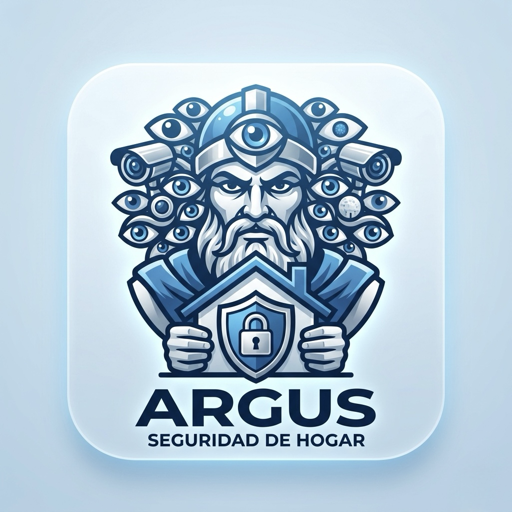

<div align="center">
  

# Argus Home Hub 🛡️

Home Assistant puede generar un paquete de diagnóstico de Argus con conteos de entidades y estado básico de TTS. Los datos se agregan sin incluir IDs de entidades, PIN, entidad TTS ni nombres de reproductores.

**Sistema Integral de Seguridad Residencial Inteligente, Local y Profesional para Home Assistant**

### Argus v3.7.4

Dashboard contextual, zonas opcionales, armado en espera, bypass temporal con reincorporación manual, diagnóstico y pruebas de sensores, voz general y accesibilidad.

**Actualización desde v2.6.8:** conserva la integración existente y sus entidades. Lee la [guía de migración](docs/MIGRATION_3.0.0.md) y las [notas de versión](docs/RELEASE_NOTES_3.0.0.md) antes de actualizar. Las novedades se configuran voluntariamente; no es obligatorio activar Zonas.

Objetivo: Home Assistant Core 2026.11.0. El frontend compilado está incluido; Node.js no es necesario para instalar Argus.

<br>

> 🌟 **¡Apoya el desarrollo de Argus!**
> 
> • **⭐ Dale una estrella en GitHub:** [https://github.com/Chrisalvir1/Argus](https://github.com/Chrisalvir1/Argus)  
> • **☕ Apoya en PayPal:** [https://paypal.me/CEstradaAlvir](https://paypal.me/CEstradaAlvir)  
> • **✉️ Correo para sugerencias y soporte:** [chrisalvir01@gmail.com](mailto:chrisalvir01@gmail.com)

</div>

---

## Novedades de v3.7.4

- El detalle de zonas sustituye la vista principal dentro del mismo panel, conservando el estado confirmado y los conteos globales. No es necesario salir de fullscreen.
- Sensores ocultos inicialmente en desarmado; Zonas cuenta las activas, Listas las verificables cerradas/inactivas y Pendientes las que tienen actividad. Estados sin verificar se indican aparte.
- Conteos completos y selector compacto operables; lista de sensores con desplazamiento interior y cierre que restaura el resumen.
- Corrección compartida por Argus Card y Home Hub. El diseño, los colores y la animación del núcleo se conservan.

[Notas de v3.7.4](docs/RELEASE_NOTES_3.7.4.md). Verificación en Chromium local con datos simulados; Safari/iPhone y Echo Show físicos pendientes.

## Novedades de v3.7.3

- Mantener separación por reproductor después de que HA acepte el TTS para reducir interrupciones entre avisos consecutivos.
- Usar duración y posición del contenido nuevo cuando están disponibles y una espera estimada cuando el reproductor no informa la finalización.
- Ampliar el timeout de síntesis/entrega de 15 a 60 segundos.

[Notas de v3.7.3](docs/RELEASE_NOTES_3.7.3.md). La reproducción física en AirPlay y otros altavoces sigue pendiente de confirmación.

## Novedades de v3.7.2

- Verificación limitada a sensores de las zonas; conteos accionables y acceso directo desde cristales.
- Ajuste del contexto en pantalla completa y giro SVG sin WebGL en pantallas táctiles bajas; respeta movimiento reducido.
- Voz por aviso con frase normal, zonas y estados seleccionables. Argus calcula las cantidades según Home Assistant. [Guía del editor](docs/VOICE_EDITOR.md).
- Anuncios con modo real, causa de alarma y perfil autenticado al desarmar desde Argus. HomeKit identifica el origen, pero no proporciona el nombre de la persona.

[Notas de v3.7.2](docs/RELEASE_NOTES_3.7.2.md). La validación visual y la reproducción física en la instalación del usuario siguen pendientes.

## Novedades de v3.0.5

- En pantalla completa vertical, el núcleo usa el espacio visible que queda después de medir cabecera, modos y panel de control; los controles mantienen sus tamaños y el núcleo se reduce si el contenido crece.
- Corregir la cascada CSS que impedía aplicar el tamaño medido y detectar orientación desde el viewport.
- Evitar que el nombre de la casa, el estado en línea y el botón de salida se encimen en móviles estrechos; en esos anchos la cabecera usa dos filas.
- Mejorar el fallback SVG para zonas: etiquetas mayores, nombre completo accesible y selección por toque o teclado.
- Mantener el fondo del contexto transparente para quitar el rectángulo azul ajeno al panel.

La verificación automatizada cubre TypeScript, build y 69 pruebas frontend. La revisión visual en iPhone y Echo Show aún debe confirmarse al actualizar.

## Novedades de v3.0.4

- Asignar sensores heredados de todos los modos directamente a zonas y conservar búsqueda, foco y posición al editar la selección.
- Mantener el giro del emblema SVG en equipos sin WebGL, también cuando hay zonas.
- Ajustar HUD y controles en horizontal/vertical y alinear las esquinas del emblema con la parte visible del panel.
- Incluye correcciones de zonas desactivadas, voz, alto contraste y legibilidad introducidas en v3.0.3.

## Novedades de v3.0.3

- Ocultar indicadores de zonas desactivadas, corregir error de carga TTS (`yaml`), aplicar contraste alto al historial y ajustar el núcleo vertical según el contenido.
- Mejorar legibilidad a distancia y añadir giro CSS ligero del núcleo para equipos en modo de rendimiento esencial o sin WebGL. Respeta movimiento reducido.
- Incluye las correcciones descritas en las notas 3.0.1 y 3.0.2.

## Novedades de v3.0.1

- Zonas opcionales: los sensores heredados siguen visibles y pueden importarse al borrador de una zona antes de guardar. Revisa las condiciones si un sensor tenía reglas diferentes por modo.
- Cabecera y núcleo separados en pantalla completa vertical; verificación en una vista desplazable y oculta cuando zonas están desactivadas.
- Núcleo de seguridad y Emblema Argus disponibles en el perfil; las preferencias antiguas de Escudo de cristal vuelven al Núcleo.
- Configuración de voz desplegada y vinculada a la alarma seleccionada. Los mensajes son generales y usan el contexto de modos, zonas y sensores.
- Color y efecto por luz compatible, con respiración lenta, media o rápida cuando Home Assistant declara soporte de transiciones.
- Historial adaptado a alto contraste, incluida la fecha y el usuario.

Lee las [notas de v3.0.1](docs/RELEASE_NOTES_3.0.1.md). La validación visual en iPhone, las luces físicas y el error TTS concreto siguen pendientes.

## Dependencias y entorno de desarrollo

Config YAML opcional y detallado: [examples/configuration.yaml](examples/configuration.yaml). La voz se configura preferentemente en Argus → Modos / SOS → Voz de Argus. El YAML solo requiere `arming_voice` y permite definir motor, reproductores y textos predeterminados.

Versiones fijadas por el lockfile: React/React DOM 19.3.1, Vite 8.3.6, TypeScript 7.0.2, Three.js 0.187.0 y react-grid-layout 2.3.0. El entorno declarado usa Node.js 26.13.0 y Python 3.14.10. La integración no instala paquetes Python adicionales y usa el Python proporcionado por Home Assistant. Estas versiones describen el entorno declarado; no sustituyen las pruebas en tu instalación.

## 📖 ¿Qué es Argus Home Hub?

**Argus Home Hub** es un centro de seguridad residencial avanzado, local e independiente para Home Assistant, diseñado para proteger tu hogar con total privacidad, sin suscripciones mensuales y sin depender de servicios externos en la nube. 

Construido sobre una arquitectura ultra-ligera de última generación con **TypeScript 7 + Vite 8.3 + React 19.3 + react-grid-layout 2.3**, Argus combina una estética cinematográfica de **Liquid Glass (Cristal Líquido)** con un motor de seguridad de grado profesional, compatibilidad nativa con HomeKit, asistente de voz interactivo (TTS), notificaciones móviles inteligentes y un **Nuevo Modo de Alto Contraste / Modo Oscuro OLED** enfocado en máxima accesibilidad visual.

### Arquitectura

React, TypeScript y Vite para la interfaz; núcleo original Three.js con calidad adaptativa. Integración Python local con Home Assistant y actualizaciones por WebSocket. Las versiones exactas de desarrollo están en `package-lock.json`, `.python-version` y `pyproject.toml`.

> [!IMPORTANT]
> **Aviso de Responsabilidad:** Argus es un sistema de automatización y seguridad residencial local de código abierto para Home Assistant. No sustituye una central receptora de alarmas certificada ni garantiza conexión directa con servicios de policía o bomberos. Asegúrate de probar periódicamente sensores, sirenas, avisos sonoros y respaldos.

---

## ✨ Características Principales

### 🛡️ Motor de Seguridad y Alarma Multimodo
- **4 Estados de Protección:** *Desarmado*, *En Casa (Arm Home)*, *Fuera de Casa (Arm Away)* y *Noche (Arm Night)*.
- **Tiempos de Gracia Configurables:** Retardos independientes de salida y entrada por cada modo para evitar falsas alarmas al entrar o salir.
- **Disparo Instantáneo:** Modo de intrusión con activación configurable de sirenas internas, externas, luces parpadeantes y scripts de emergencia.
- **Detección Activa de Sensores Abiertos:** Al intentar armar, Argus comprueba inmediatamente todas las puertas, ventanas y sensores vinculados. Si alguno está abierto, lo notifica en pantalla y por voz (TTS) y te permite cerrarlo o aplicar **Bypass (Omitir)** de forma individual con un solo toque.

### 🖤 Nuevo: Modo Alto Contraste & Modo Oscuro OLED (Accesibilidad)
- **Activación Directa en el Perfil:** Alterna fácilmente entre el aspecto estándar *Liquid Glass* y el tema *Alto Contraste*.
- **Diseñado para la Legibilidad y Pantallas OLED:** Fondos profundos con negros puros, textos de máximo contraste (blanco nítido y gris claro), bordes definidos y eliminación de transparencias reflectantes para una lectura cómoda bajo luz solar o en habitaciones oscuras.
- **Soporte de Sistema Operativo:** Respeta automáticamente la preferencia de accesibilidad `@media (prefers-contrast: more)`.

### 📱 Deslizador de Seguridad iOS (Slide-to-Action)
- **Seguro contra Toques Accidentales:** Sustituye botones convencionales por controles deslizantes táctiles fluidos tipo *"Deslizar para desarmar"* o *"Deslizar para activar SOS"*, inspirados en el diseño de iOS.
- **Protección para Niños y Mascotas:** Impide desarmes o alertas de pánico involuntarias causadas por roces en tablets de pared o pantallas táctiles.

### 🧩 Dashboard Modular Interactivo (React 19)
- **Widgets Arrastrables y Redimensionables:** Basado en `react-grid-layout`, organiza tus tarjetas de seguridad, historial, automatizaciones y control de acceso a tu gusto mediante arrastre y cambio de tamaño.
- **Persistencia por Dispositivo:** El diseño y la distribución de widgets se memorizan localmente según el tamaño de la pantalla (teléfono, tablet de pared, monitor de escritorio o pantalla en formato Kiosk).

### 🗣️ Asistente de Voz Inteligente (TTS Dinámico)
- **Anuncios por Altavoces en Vivo:** Notificaciones habladas automáticas a través de cualquier reproductor multimedia (`media_player`) de Home Assistant.
- **Información Precisa:** Si una puerta impide el armado, Argus te dirá exactamente: *"No se puede armar. La puerta principal está abierta"*. También anuncia cuentas regresivas de salida y alarmas activadas.

### 🔑 Control de Acceso Criptográfico y Gestión de Pines
- **Separación Rigurosa de Credenciales:**
  - **Pin de Armado (Master PIN):** Controla exclusivamente el armado, desarmado y cancelación del pánico de las instancias de alarma.
  - **Pin de Perfil (Access PIN):** Protege la apertura del panel Argus y el cambio de usuarios.
- **Cifrado Seguro:** Hashing de contraseñas mediante algoritmos criptográficos locales (`scrypt` / PBKDF2), protegiendo tus claves de cualquier fuga en el frontend.
- **Gestión Multi-Usuario con Permisos Granulares:** Asigna roles (Administrador o Usuario Estándar) y permisos específicos (Ver estado, Armar, Desarmar, Ver historial, Gestionar pines) con insignia visual de estado.

### 🚨 Botón de Pánico y Acciones de Emergencia SOS
- **Activación Rápida y Segura:** Activación manual protegida por confirmación o deslizador táctil.
- **Dispositivos de Auxilio Automáticos:** Dispara automáticamente sirenas, luces de advertencia y rutinas preconfiguradas, incluso con el sistema desarmado.
- **Teléfono de Emergencias Local:** Botón de llamada rápida configurable según tu país o región (911, 112, etc.).
- **Detención Reversible:** Permite cancelar el pánico restaurando el sistema exactamente al estado de seguridad anterior.

### 📲 Notificaciones Móviles Inteligentes y Alertas Críticas (iOS y Android)
Argus se integra de forma directa y nativa con la aplicación Home Assistant Companion para alertarte de cualquier evento de seguridad en tu móvil:
- **Alertas Críticas de Máxima Prioridad:** Notificaciones push de emergencia con sonido de sirena estridente que ignoran automáticamente el modo silencioso o No Molestar del dispositivo.
- **Destinos configurables:** Selecciona los servicios móviles disponibles en Home Assistant. La entrega depende de la aplicación Companion y de la configuración del dispositivo.

### 📦 Copias de Seguridad Cifradas (.argus)
- **Exportación e Importación Completa:** Descarga y restaura perfiles, sensores, configuraciones de modos y ajustes de seguridad en archivos protegidos con cifrado AES-GCM.
- **Recuperación en el Asistente Inicial:** En instalaciones nuevas o migraciones, puedes subir tu archivo de respaldo directamente en la pantalla de bienvenida.

### 🏠 Lovelace Card y Modo Kiosk
- Usa Argus en cualquier panel de Home Assistant mediante las tarjetas personalizadas `custom:argus-card` o `custom:argus-panel-card`.
- Soporte para pantalla completa sin marcos (ideal para tablets táctiles de pared).

---

## 🚀 Instalación

### Método 1: Directamente desde HACS (Oficial y Recomendado)
Argus Home Hub forma parte del **catálogo oficial por defecto de HACS**, por lo que su instalación es directa y sin configuraciones manuales de repositorios:
1. Abre **HACS** en el menú lateral de tu Home Assistant.
2. Ve a la sección **Integraciones**.
3. En el buscador superior escribe **Argus** (o **Argus Home Hub**).
4. Selecciona la integración y haz clic en **Descargar**.
5. Reinicia Home Assistant.
6. Ve a **Ajustes → Dispositivos y servicios → Añadir integración** y selecciona **Argus Home Hub**.

### Método 2: Repositorio Personalizado en HACS (Alternativa)
Si por temas de caché tu catálogo local de HACS no muestra la integración en la búsqueda:
1. En **HACS → Integraciones**, toca el menú de tres puntos (⋮) en la esquina superior derecha y selecciona **Repositorios personalizados**.
2. Añade `https://github.com/Chrisalvir1/Argus` con la categoría **Integración**.
3. Haz clic en **Añadir** y luego en **Descargar**.
4. Reinicia Home Assistant y añade la integración desde **Ajustes**.

### Método 3: Instalación Manual
1. Descarga el archivo `argus.zip` de la última versión en [Releases](https://github.com/Chrisalvir1/Argus/releases).
2. Descomprime el contenido dentro de la carpeta `custom_components/argus/` de tu instalación:
   ```
   /config/custom_components/argus/
   ```
3. Reinicia Home Assistant.
4. Añade la integración desde **Ajustes → Dispositivos y servicios**.

---

## 🔊 Configuración del Asistente de Voz

Abre **Argus → Modos / SOS → Voz de Argus**. Elige un motor TTS y los reproductores descubiertos por Home Assistant. Los ajustes antiguos se importan cuando todavía no existe una personalización en el panel.

La voz identifica el modo y los sensores correspondientes a cada acción. No es necesario escribir manualmente sus nombres. La configuración de armado en espera se conserva por modo. Consulta la [guía de migración](docs/MIGRATION_3.0.0.md) para conocer la prioridad de ajustes heredados.

---

## 📲 Tarjetas Lovelace

Para añadir la tarjeta de alarma de Argus a cualquier vista de tu Dashboard en Home Assistant:

```yaml
type: custom:argus-card
entity: alarm_control_panel.argus
title: Seguridad del Hogar
```

O si prefieres incrustar el panel completo de Argus con todas sus herramientas:

```yaml
type: custom:argus-panel-card
```

---

## 🛠️ Contribuir y Desarrollo Local

Argus cuenta con una suite completa de pruebas unitarias y verificación de contratos:

```bash
# Compilar el frontend en React 19
npm ci
npm run build

# Ejecutar pruebas unitarias de frontend
npm test

# Ejecutar suite de pruebas unitarias de backend Python
python3 scripts/test_backend.py
```

---

## 💬 Soporte, Sugerencias y Donaciones

¡La comunidad hace que Argus siga creciendo! Si tienes ideas, comentarios, encuentras un fallo o deseas colaborar:

| Canal | Enlace / Detalle |
|---|---|
| ✉️ **Correo de Sugerencias & Contacto** | [chrisalvir01@gmail.com](mailto:chrisalvir01@gmail.com) |
| ⭐ **Repositorio en GitHub** | [https://github.com/Chrisalvir1/Argus](https://github.com/Chrisalvir1/Argus) |
| ☕ **Donaciones y Apoyo en PayPal** | [https://paypal.me/CEstradaAlvir](https://paypal.me/CEstradaAlvir) |
| 🐛 **Reportar Errores o Solicitar Funciones** | [GitHub Issues](https://github.com/Chrisalvir1/Argus/issues) |
| ✈️ **Telegram** | [@cea1410](https://t.me/cea1410) |
| 📸 **Instagram** | [@chrisalvir1](https://instagram.com/chrisalvir1) |

---

## 📄 Licencia

Este proyecto está bajo la Licencia **MIT**. Consulta el archivo [LICENSE](LICENSE) para más información.

## Documentación de v3.0.0

- [Novedades y funcionamiento](docs/RELEASE_NOTES_3.0.0.md)
- [Migración desde v2.6.8](docs/MIGRATION_3.0.0.md)
- [Validación y limitaciones](docs/RELEASE_VALIDATION_3.0.0.md)
- [YAML opcional de voz](examples/configuration.yaml)
